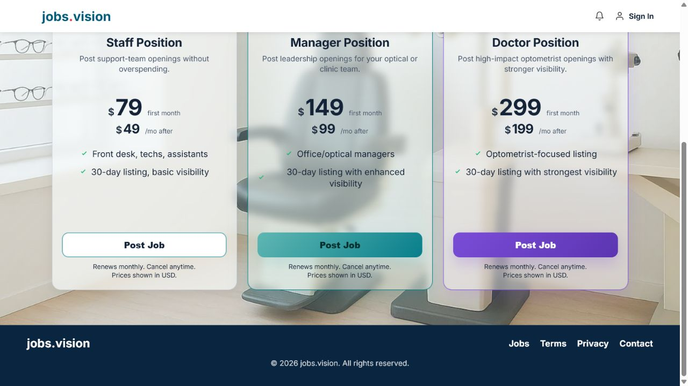
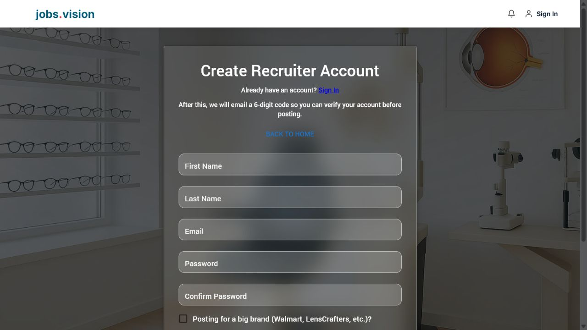
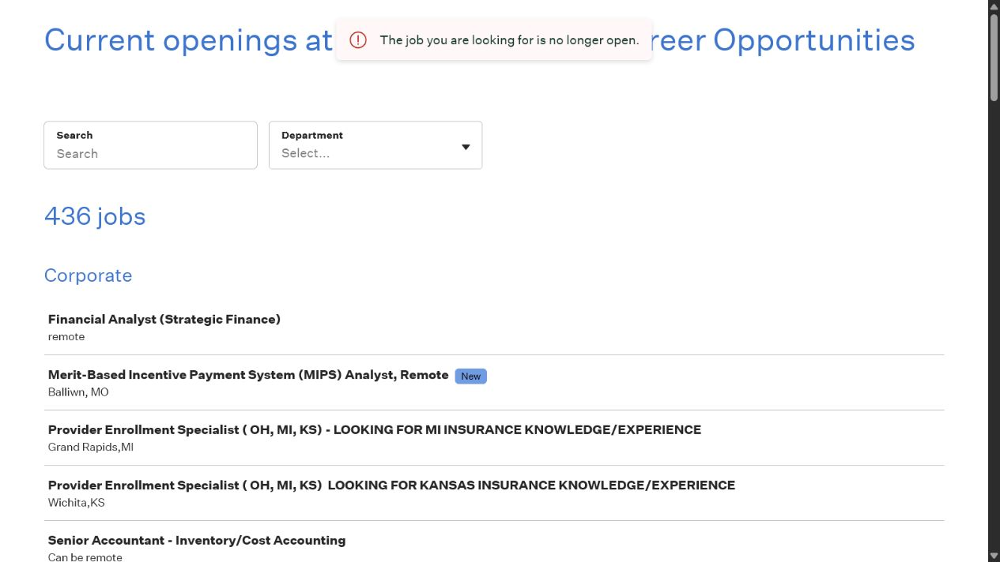
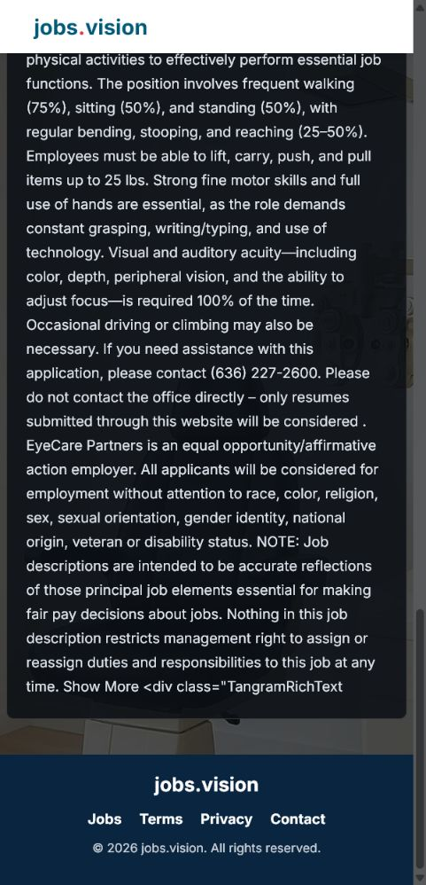

# jobs.vision End-to-End UX, Workflow, and Conversion Audit

Audit date: July 28, 2026 (America/Chicago)  
Target: https://www.jobs.vision/  
Perspective: brand-new, signed-out visitor using a fresh isolated browser session

## Executive Summary

jobs.vision has a polished visual identity, a clearly defined eye-care niche, public candidate and recruiter pricing, and usable client-side validation. Those strengths are outweighed by a launch-blocking job-freshness problem and several conversion gaps.

The most serious finding is that all three sampled live listings sent candidates to an employer application board that reported the job was no longer open. Two of the three sampled job descriptions also contained ingestion artifacts or broken markup. Until listing freshness and content sanitation are reliable, paid acquisition or broader launch promotion would risk sending candidates into dead ends and weakening recruiter trust.

Recruiter pricing is visible, but the fee model is not unambiguous. The pricing cards suggest listing-based billing through “30-day listing” and “Post Job,” yet the amounts are described as recurring monthly charges without saying “per listing.” Clicking a plan then lands on “Create Recruiter Account” with no statement that the account is free, no selected-plan summary, and no price. A reasonable recruiter could therefore believe that a recruiter account itself carries a recurring fee.

Candidate conversion also loses intent: clicking Plus leads to a generic candidate registration form with no mention of Plus, its price, included features, or what happens after registration. On mobile, the navigation disappears and the job results are pushed below a large filter panel and a premium map upsell.

### Scores

| Score | Result | Rationale |
|---|---:|---|
| Overall Launch Readiness | **43/100** | Attractive public shell, but live application destinations failed in a 3/3 sample and authenticated/payment journeys remain unverified. |
| Candidate Experience | **39/100** | Strong niche and filters; stale apply links, weak listing summaries, malformed descriptions, and mobile friction materially damage the core task. |
| Recruiter Experience | **53/100** | Pricing and a dedicated signup route exist, but billing semantics, plan context, and downstream workflow are unclear or unverified. |
| Conversion Confidence | **36/100** | High abandonment risk at job apply, plan-to-registration handoff, login, mobile browse, and pre-checkout trust stages. |

## Method, Safety, and Test Boundaries

- Used a fresh isolated browser session with no observed logged-in state; every tested page presented the signed-out experience.
- Tested public discovery, navigation, pricing, job search, job details, three application destinations, candidate and recruiter registration forms, login, verification recovery, password recovery, legal/support pages, 404 behavior, mobile-like narrow viewport behavior, and unauthenticated admin access.
- Used fake invalid values only to exercise client-side validation. No account was created.
- Did not submit a registration, send a verification/reset email, upload a resume, create/edit a listing, create an applicant record, initiate a Stripe Checkout session, charge a card, request a refund, or modify admin data.
- Because creating an account would modify production data, authenticated dashboards, billing history, confirmation emails, resume upload, listing management, and Stripe success/failure states are marked **Not tested**, not inferred.
- Admin `/admin` correctly redirected to `/login?next=%2Fadmin`; no admin screens were accessed.

## Journey Coverage

| Journey | Status | Evidence-based result |
|---|---|---|
| Anonymous homepage / 5-second test | Tested | Eye-care niche and two-sided marketplace are apparent; inventory proof, trust proof, and the commercial model are not. |
| Candidate vs recruiter pathways | Tested | Tabs are visible on desktop, but not represented in persistent navigation; mobile header exposes only the logo. |
| Job search/filtering | Tested | Rich filters and live search work, but results load behind a false zero state and are buried on narrow screens. |
| Job details | Tested, 3-listing sample | Sparse decision data; 2/3 descriptions contained ingestion artifacts; 3/3 apply destinations were closed. |
| Candidate registration | Tested to submit boundary | Required-field, invalid-email, and password-match validation work. Plan intent is lost; no sign-in or terms acknowledgment is presented in the form. |
| Candidate verification/recovery | Tested without email send | Verification page is reachable without registration and claims a code was sent before an email is supplied. Login presents three competing authentication/recovery actions. |
| Candidate dashboard/profile/resume/saves/returning state/emails | Not tested | Requires creation/use of production account data. |
| Recruiter discovery/pricing | Tested | Public prices are visible, but “per listing” and “free account” are never stated explicitly. |
| Recruiter registration | Tested to submit boundary | Validation works and sign-in is linked. Selected listing type and price are lost; “big brand” checkbox is unexplained. |
| Recruiter checkout/post/edit/dashboard/applicants/billing/emails | Not tested | Requires production account, payment, or listing data. |
| Stripe/taxes/fees/success/failure/mobile checkout | Not tested | Checkout was not reachable without creating production account data. Public legal copy says Stripe is used. |
| Admin | Access control only | `/admin` redirected to login. Dashboard, users, listings, billing, and refunds were not accessible. |

## Direct Answers: Recruiter Account Fee Confusion

### Would a reasonable recruiter believe there is a “Recruiter Account” fee?

**Yes, reasonably.** The recruiter pricing cards show recurring monthly amounts, the CTA is “Post Job,” and the next screen is headed “Create Recruiter Account.” The registration screen never says the account is free, never says payment is only for a listing, and does not retain the selected listing or price. That sequence can be read as creating a paid recruiter subscription.

### Is it obvious that recruiters pay per listing rather than for an account?

**Only partially on the pricing screen, and not throughout the funnel.** “30-day listing” and “Post Job” suggest listing-based billing. However, “first month,” “/mo after,” and “Renews monthly” do not say “for this listing” or “per listing.” The registration step removes the remaining listing context.

### Where exactly does the messaging become confusing?

1. Home → **Post a Job** cards: monthly recurring prices are shown without the phrase “per listing.”
2. The same cards say both “30-day listing” and “Renews monthly,” without explaining that one listing remains live and renews in 30-day periods.
3. Clicking a specific card opens `/recruiter/register` with the generic heading **Create Recruiter Account**.
4. The recruiter form shows no “Free account,” no “No charge today,” no selected role/listing tier, and no price.
5. The Terms use the broader phrase “Paid recruiter and candidate services,” which does not resolve whether the account or listing is billed.

### Smallest changes that eliminate the confusion

1. Add one line above recruiter cards: **“Recruiter accounts are free. Pay only for each job listing.”** (XS)
2. Change each price label to: **“$79 for the first 30 days of this listing; $49 per 30-day renewal.”** (XS)
3. Change the registration heading to **“Create your free recruiter account”** and add **“No charge today.”** (XS)
4. Preserve the chosen tier in the URL/session and show a compact summary on registration: **“Staff listing — $79 first 30 days. You’ll review before checkout.”** (S)
5. Change the CTA to **“Create free account & post this job.”** (XS)

Evidence:

## Issue Register

| ID | Severity | Category | Issue | Effort |
|---|---|---|---|---|
| F01 | Critical | Bug, Conversion, Trust | 3/3 sampled listings sent candidates to closed employer jobs | M |
| F02 | High | Bug, Trust, UX | Job description ingestion exposes broken markup or scraped-page noise | M |
| F03 | High | Conversion, UX, Copy | Candidate Plus intent and price are lost at registration | S |
| F04 | High | Conversion, Copy, Trust | Recruiter account vs per-listing fee is ambiguous | XS–S |
| F05 | High | Mobile, UX, Conversion | Narrow-screen header removes navigation and Sign In | S |
| F06 | High | Mobile, Conversion, UX | Filters and premium map upsell push jobs far below the fold | M |
| F07 | High | Conversion, UX, Copy | Login exposes three competing actions without explanation or registration links | S |
| F08 | High | Bug, UX, Conversion | Unknown routes render a blank content area instead of a 404 | XS |
| F09 | High | Accessibility, Bug | Job cards nest buttons and links inside a button | M |
| F10 | Medium | Bug, Conversion | Results initially announce “0 jobs / No jobs available” before loaded jobs appear | S |
| F11 | Medium | UX, Conversion | Job cards omit employer, date, pay, type, and teaser data | M |
| F12 | Medium | UX, Trust | Job detail omits core decision data and freshness reassurance | M |
| F13 | Medium | UX, Conversion | Anonymous save/track actions use an abrupt browser confirm pattern | S |
| F14 | Medium | Conversion, Trust, Copy | Candidate registration lacks sign-in, plan summary, and form-level legal acknowledgment | S |
| F15 | Medium | UX, Copy, Trust | Recruiter “big brand” checkbox is unexplained and business identity is not collected | S |
| F16 | Medium | Trust, Bug | Password requirement is only six characters and is not disclosed before error | XS |
| F17 | Medium | Bug, Copy, UX | Verification page says a code was sent even when reached without an email | XS |
| F18 | Medium | Trust, Conversion, Copy | Renewal, cancellation, and refund behavior are not explained next to price | XS |
| F19 | Medium | Trust, Conversion | Checkout costs, taxes, fees, and refund expectations cannot be reviewed before account creation | S |
| F20 | Medium | Trust, Conversion | Homepage and support pages lack marketplace proof and operator identity | S |
| F21 | Medium | Copy, UX | Candidate/recruiter/listing terminology changes across screens | XS |
| F22 | Medium | Copy, Trust | Privacy policy hedges whether resume/profile features are enabled | XS |
| F23 | Medium | Performance | Google Maps loads for signed-out users behind an upsell and emits implementation warnings | M |
| F24 | Low | Accessibility, UX | Page titles are reused across registration, login, and content pages | XS |
| F25 | Low | UX, Copy | Anonymous search exposes “Show Hidden Jobs” and unexplained status/icon concepts | XS |
| F26 | Low | Trust | Contact page offers only an email address with no response expectation or business identity | XS |

## Detailed Findings

### F01 — Closed application destinations

- **Severity:** Critical
- **Category:** Bug, Conversion, Trust
- **Steps to reproduce:** Open `/jobs`; open the Office Manager listing in Southern Shores, the Medical Assistant listing in Mount Carmel, or the Office Manager listing in Birmingham; click **Apply on Employer Site**; follow the employer’s embedded Greenhouse job token.
- **Expected:** The application button opens the specific, active job and its application form.
- **Actual:** All three sampled job tokens redirected to a Greenhouse job board with **“The job you are looking for is no longer open.”**
- **Screenshot:** [Closed employer job](screenshots/13-apply-destination-closed.png)
- **Recommended fix:** Validate external application URLs during import and on a scheduled cadence; immediately unpublish jobs that return a closed/error state; add an “Report closed job” action; record last-validated time; block stale feed records from search.
- **Effort:** M

### F02 — Malformed and noisy job descriptions

- **Severity:** High
- **Category:** Bug, Trust, UX
- **Steps to reproduce:** Open the Southern Shores Office Manager or Birmingham Office Manager job detail; scroll to the end. Open the sampled Mount Carmel Medical Assistant detail.
- **Expected:** Clean, employer-authored description with safe formatting.
- **Actual:** Two of three sampled descriptions contained visible ingestion artifacts such as `Show More <div class="TangramRichText"`. Another began with scraped navigation/application text such as “You need to enable JavaScript,” repeated title/location, and “Apply Now.”
- **Screenshot:** [Visible markup leak](screenshots/05-job-detail-broken-markup.png)
- **Recommended fix:** Sanitize and normalize imported HTML server-side; strip navigation, scripts, controls, “Show More,” and raw tag remnants; add automated content-quality tests and quarantine malformed imports.
- **Effort:** M

### F03 — Candidate Plus intent is lost

- **Severity:** High
- **Category:** Conversion, UX, Copy
- **Steps to reproduce:** Home → Find a Job → Plus → **Create account**.
- **Expected:** Registration confirms the selected Plus plan, $20/month price, benefits, and next step; or the CTA clearly says signup is step one.
- **Actual:** `/candidate/register` is generic. It does not mention Plus, $20/month, checkout, trial, billing cadence, or what happens after registration.
- **Screenshot:** [Generic candidate registration](screenshots/06b-candidate-registration-context-loss.png)
- **Recommended fix:** Carry `plan=plus`; show a compact plan summary and “No charge until you review checkout”; keep an edit-plan link.
- **Effort:** S

### F04 — Recruiter fee model is ambiguous

- **Severity:** High
- **Category:** Conversion, Copy, Trust
- **Steps to reproduce:** Home → Post a Job → review a price card → click **Post Job**.
- **Expected:** Every step says recruiter accounts are free and the recurring amount applies to one listing.
- **Actual:** Cards say “first month,” “/mo after,” and “Renews monthly,” then the next page says “Create Recruiter Account” with no price or free-account statement.
- **Screenshots:** [Pricing](screenshots/02b-recruiter-pricing-cta.png), [registration](screenshots/08-recruiter-registration.png)
- **Recommended fix:** Apply the five minimal copy/context changes in the direct-answer section.
- **Effort:** XS–S

### F05 — Mobile navigation disappears

- **Severity:** High
- **Category:** Mobile, UX, Conversion
- **Steps to reproduce:** Open homepage, jobs, job detail, or auth pages at the tested narrow width (~482 CSS px).
- **Expected:** A hamburger or compact navigation exposes Jobs, Sign In, and recruiter/candidate routes.
- **Actual:** The header shows only the jobs.vision logo. Sign In and navigation are absent.
- **Screenshot:** [Mobile job detail header](screenshots/04-job-detail-mobile-top.png)
- **Recommended fix:** Add an accessible mobile menu; retain a visible Sign In action; include Jobs, Post a Job, Pricing, and account creation.
- **Effort:** S

### F06 — Mobile results are buried

- **Severity:** High
- **Category:** Mobile, Conversion, UX
- **Steps to reproduce:** Open `/jobs` at the narrow viewport.
- **Expected:** Search and primary filters appear first, followed by results; advanced filters and map upsell are collapsed.
- **Actual:** A tall filter panel, locked “Advanced OD Filters,” and a large map upsell consume the first screens before any result card.
- **Screenshots:** [Top of mobile search](screenshots/03b-jobs-visible-browser.png), [results after scrolling](screenshots/11-job-search-results-contradiction.png)
- **Recommended fix:** On narrow screens show keyword, location, and a **Filters (n)** button; move map into a tab/drawer; show the first three results before the upsell.
- **Effort:** M

### F07 — Login has competing, unexplained actions

- **Severity:** High
- **Category:** Conversion, UX, Copy
- **Steps to reproduce:** Open `/login`.
- **Expected:** One primary sign-in action; passwordless sign-in and verification recovery are clearly secondary and explained; candidate/recruiter registration links are present.
- **Actual:** **Sign In**, **Email Me a Sign-In Code**, and **Continue Verification** all appear without explaining when to use each. There is no “Create candidate account” or “Create recruiter account.”
- **Screenshot:** [Login actions](screenshots/07-login-confusing-actions.png)
- **Recommended fix:** Keep Sign In primary; label passwordless as “Use a one-time code instead”; show Continue Verification only when a pending verification email exists; add both registration links.
- **Effort:** S

### F08 — Blank 404

- **Severity:** High
- **Category:** Bug, UX, Conversion
- **Steps to reproduce:** Open any unknown path such as `/this-route-does-not-exist-audit`.
- **Expected:** Branded 404 with explanation, search, Browse Jobs, Post a Job, and Home actions.
- **Actual:** Header, background, and footer render around an empty content area.
- **Screenshot:** [Blank 404](screenshots/14-blank-404.png)
- **Recommended fix:** Add a route-level 404 component with recovery CTAs.
- **Effort:** XS

### F09 — Invalid nested interactive job cards

- **Severity:** High
- **Category:** Accessibility, Bug
- **Steps to reproduce:** Inspect a loaded job card with assistive technology or DOM semantics.
- **Expected:** Card container is non-interactive; title is a link; Save, Applied, and Hide are sibling buttons with independent focus.
- **Actual:** The card is exposed as a button containing three buttons and a link. Its accessible name concatenates all controls and content.
- **Screenshot:** [Job cards](screenshots/11-job-search-results-contradiction.png)
- **Recommended fix:** Use `<article>`/`<li>` for the card, a single title link, and sibling icon buttons; ensure logical tab order and visible focus.
- **Effort:** M

### F10 — False zero-result state while data loads

- **Severity:** Medium
- **Category:** Bug, Conversion
- **Steps to reproduce:** Open `/jobs` or enter “Office Manager”; observe the status immediately and again after results settle.
- **Expected:** Loading skeleton/status until the result set is ready.
- **Actual:** The page temporarily announces “0 jobs found / No jobs available,” then updates to 21 jobs.
- **Screenshots:** [Search state](screenshots/10-job-search-zero-results-bug.png), [loaded result state](screenshots/11-job-search-results-contradiction.png)
- **Recommended fix:** Separate `loading`, `loaded-empty`, and `loaded-with-results` states; never render empty copy while fetching.
- **Effort:** S

### F11 — Job cards lack decision data

- **Severity:** Medium
- **Category:** UX, Conversion
- **Steps to reproduce:** Browse job results.
- **Expected:** Employer, posting age, employment type, work setting, compensation when available, and a short teaser are visible.
- **Actual:** Cards primarily show title, role, and location. Users must open each job to learn the employer or other details.
- **Screenshot:** [Sparse job cards](screenshots/11-job-search-results-contradiction.png)
- **Recommended fix:** Add company, date/freshness, type/setting, pay, and a short snippet; reduce vertical card height.
- **Effort:** M

### F12 — Job detail lacks core decision and freshness information

- **Severity:** Medium
- **Category:** UX, Trust
- **Steps to reproduce:** Open a job detail.
- **Expected:** Salary/pay transparency, type, work setting, employer verification, last-validated timestamp, save/track action, and external-application disclosure.
- **Actual:** The sampled detail showed employer, location, role, posted date, and a long description, but not compensation, employment type, freshness validation, verification, or candidate tracking controls.
- **Screenshot:** [Job detail](screenshots/04-job-detail-mobile-top.png)
- **Recommended fix:** Add a structured summary block, “Verified active” timestamp, employer identity, report control, save/track action, and “Opens employer site” disclosure.
- **Effort:** M

### F13 — Anonymous save uses abrupt browser dialog behavior

- **Severity:** Medium
- **Category:** UX, Conversion
- **Steps to reproduce:** Signed out on `/jobs`, activate a Save/Applied/Hide icon.
- **Expected:** Accessible in-page modal explaining the benefit and offering candidate registration or sign-in.
- **Actual:** The interaction triggers a native confirmation pattern; icon meaning is mainly communicated through title/accessible text.
- **Screenshot:** [Unexplained card icons](screenshots/11-job-search-results-contradiction.png)
- **Recommended fix:** Use a small accessible conversion modal with **Create free candidate account** and **Sign in**.
- **Effort:** S

### F14 — Candidate registration lacks recovery and trust context

- **Severity:** Medium
- **Category:** Conversion, Trust, Copy
- **Steps to reproduce:** Open `/candidate/register`.
- **Expected:** “Already have an account? Sign in,” selected plan summary, verification expectation, and agreement text linking Terms and Privacy.
- **Actual:** Only **Back to Home** is available above the fields. The form has no plan or legal acknowledgment.
- **Screenshots:** [Candidate registration](screenshots/06b-candidate-registration-context-loss.png), [validation](screenshots/06-candidate-registration-validation.png)
- **Recommended fix:** Add sign-in, verification expectation, plan summary, and “By creating an account…” Terms/Privacy copy.
- **Effort:** S

### F15 — Recruiter identity step is unclear

- **Severity:** Medium
- **Category:** UX, Copy, Trust
- **Steps to reproduce:** Open `/recruiter/register`.
- **Expected:** Collect organization/company name and explain any brand verification requirement.
- **Actual:** The only business-related input is **“Posting for a big brand (Walmart, LensCrafters, etc.)?”** with “Independent clinics can use any email.” The operational consequence is unclear.
- **Screenshot:** [Recruiter registration](screenshots/08-recruiter-registration.png)
- **Recommended fix:** Collect company/clinic name; rename the checkbox to a clear organization-type choice; explain domain verification and what happens next.
- **Effort:** S

### F16 — Weak and undisclosed password rule

- **Severity:** Medium
- **Category:** Trust, Bug
- **Steps to reproduce:** Submit either registration form empty or with a short password.
- **Expected:** Requirements appear before typing and follow a stronger policy or passphrase guidance.
- **Actual:** The rule appears only after submission and accepts a minimum of six characters.
- **Screenshot:** [Six-character rule](screenshots/06-candidate-registration-validation.png)
- **Recommended fix:** Require a stronger minimum (or password strength/passphrase policy), show it before error, support password-manager autocomplete, and add show/hide.
- **Effort:** XS

### F17 — Verification page claims a code was sent without context

- **Severity:** Medium
- **Category:** Bug, Copy, UX
- **Steps to reproduce:** `/login` → **Continue Verification** without a pending registration.
- **Expected:** Ask for email first or display pending-registration context only when it exists.
- **Actual:** `/verify-email` immediately says “Check your email for a 6-digit verification code” while the email field is empty.
- **Screenshot:** [Verification state](screenshots/09-verification-misleading-state.png)
- **Recommended fix:** If no pending email exists, change the intro to “Enter your registration email to resend a code”; show sent-state copy only after a successful API response.
- **Effort:** XS

### F18 — Renewal and refund details are too far from the decision

- **Severity:** Medium
- **Category:** Trust, Conversion, Copy
- **Steps to reproduce:** Review recruiter or candidate pricing.
- **Expected:** Clear billing object, cadence, cancellation effective date, refund rule, and a linked policy next to CTA.
- **Actual:** Cards say “Renews monthly. Cancel anytime. Prices shown in USD.” Terms later explain that cancellation stops future charges and does not automatically refund paid charges.
- **Screenshot:** [Recruiter price footnotes](screenshots/02b-recruiter-pricing-cta.png)
- **Recommended fix:** Add “Renews this listing every 30 days until canceled; cancellation stops the next renewal; prior charges are non-refundable except where required.”
- **Effort:** XS

### F19 — Checkout trust cannot be evaluated before account creation

- **Severity:** Medium
- **Category:** Trust, Conversion
- **Steps to reproduce:** Select any paid candidate or recruiter tier while signed out.
- **Expected:** A pre-checkout summary explains price, taxes/fees treatment, renewal, refund rule, and the fact that Stripe handles payment.
- **Actual:** The funnel goes directly to generic account creation. No order summary or tax/fee expectation is available at that stage.
- **Screenshot:** [Recruiter context loss](screenshots/08-recruiter-registration.png)
- **Recommended fix:** Add a persistent order summary before account submission and repeat it on Stripe Checkout. State whether tax is calculated at checkout and whether any platform fee exists.
- **Effort:** S

### F20 — Missing proof and operator trust

- **Severity:** Medium
- **Category:** Trust, Conversion
- **Steps to reproduce:** Review homepage and Contact.
- **Expected:** Current job count, employer/candidate proof, how listings are sourced/verified, organization identity, security/payment badges, and support expectations.
- **Actual:** Homepage is primarily hero + price cards. Contact provides only `support@jobs.vision`.
- **Screenshot:** [Homepage](screenshots/01-home-desktop.png)
- **Recommended fix:** Add “How it works,” live verified-job count, recent jobs, employer logos/testimonials when legitimate, verification/freshness policy, Stripe badge, company/legal identity, and support response target.
- **Effort:** S

### F21 — Terminology drifts

- **Severity:** Medium
- **Category:** Copy, UX
- **Steps to reproduce:** Compare homepage, jobs page, registration, Terms, and recruiter pricing.
- **Expected:** One controlled vocabulary.
- **Actual:** Candidate concepts appear as **Basic / Plus / Premium**, **Candidate Plus**, **Candidate Premium**, **Candidate Registration**, and candidate “services.” Recruiter concepts appear as **Post a Job**, **Staff/Manager/Doctor Position**, **30-day listing**, **Recruiter Account**, and paid recruiter “services.”
- **Screenshot:** [Homepage plan naming](screenshots/01-home-desktop.png)
- **Recommended fix:** Standardize: “Free Candidate Account,” “Candidate Plus,” “Candidate Premium,” “Free Recruiter Account,” and “[Role] Job Listing.”
- **Effort:** XS

### F22 — Privacy policy undermines feature confidence

- **Severity:** Medium
- **Category:** Copy, Trust
- **Steps to reproduce:** Privacy → “Candidate Accounts and Applications.”
- **Expected:** State exactly which production features exist and what data each processes.
- **Actual:** Copy says “If resume uploads, candidate profiles, or richer application tools are enabled,” making current availability uncertain.
- **Screenshot:** No dedicated screenshot; observed on `/privacy`.
- **Recommended fix:** Replace conditional boilerplate with a current feature/data matrix; update it when features launch.
- **Effort:** XS

### F23 — Paywalled map still imposes cost and warnings

- **Severity:** Medium
- **Category:** Performance
- **Steps to reproduce:** Open `/jobs` signed out; inspect page behavior and console.
- **Expected:** Defer the heavy map until requested or entitled; use current Maps loading/marker APIs.
- **Actual:** Google Maps and controls render behind a Candidate Plus/Premium upsell. The console reports non-async API loading and deprecated marker usage.
- **Screenshot:** [Map behind upsell](screenshots/03b-jobs-visible-browser.png)
- **Recommended fix:** Lazy-load after an explicit map action/entitlement; use async loading and AdvancedMarkerElement; render a lightweight static preview for upsell.
- **Effort:** M

### F24 — Generic page titles

- **Severity:** Low
- **Category:** Accessibility, UX
- **Steps to reproduce:** Open login, candidate registration, recruiter registration, and content pages.
- **Expected:** Unique titles such as “Candidate Sign Up | jobs.vision.”
- **Actual:** Multiple routes reuse “jobs.vision | Optometry and Eye Care Jobs.”
- **Screenshot:** No dedicated screenshot; observed from browser titles.
- **Recommended fix:** Set route-specific metadata.
- **Effort:** XS

### F25 — Signed-out search exposes irrelevant state controls

- **Severity:** Low
- **Category:** UX, Copy
- **Steps to reproduce:** Open `/jobs` signed out.
- **Expected:** Signed-out users see search and filters relevant to public browsing.
- **Actual:** “Show Hidden Jobs,” Saved, Applied, and status icon concepts are visible even though the user has no account state.
- **Screenshot:** [Signed-out filters](screenshots/03b-jobs-visible-browser.png)
- **Recommended fix:** Hide account-state controls until sign-in; replace with a concise save benefit where appropriate.
- **Effort:** XS

### F26 — Contact page is too thin

- **Severity:** Low
- **Category:** Trust
- **Steps to reproduce:** Open `/contact`.
- **Expected:** Support categories, response expectation, company/legal identity, and billing/refund escalation path.
- **Actual:** One sentence points every issue to one email address.
- **Screenshot:** No dedicated screenshot; observed on `/contact`.
- **Recommended fix:** Add response target, business identity, billing/refund instructions, privacy contact, and status/help links.
- **Effort:** XS

## Every Identified Hesitation / Confusion Point

1. Hero communicates the niche but not why jobs.vision is safer, fresher, or better than a general job board.
2. Recruiters must infer that the **Post a Job** tab is their pathway.
3. Recruiter pricing does not explicitly say “per listing” or “free account.”
4. “30-day listing” plus “Renews monthly” requires the user to infer what renews.
5. Candidate paid-plan click lands on a generic registration page.
6. Recruiter paid-listing click lands on a generic “Create Recruiter Account” page.
7. Candidate registration does not offer Sign In.
8. Recruiter “big brand” checkbox does not explain the consequence.
9. Six-character password rule appears only after failure.
10. Login offers password, passwordless code, verification continuation, and reset without hierarchy.
11. Verification says a code was sent even when no email is known.
12. Search initially shows a false empty state.
13. Keyword parsing changes “Office Manager” into `office` plus a Manager chip without explaining the behavior.
14. Results require scrolling past dense filters and the map upsell on mobile.
15. Card icons have no visible mobile labels.
16. Cards omit the employer and common decision information.
17. Apply sends the user to a different site.
18. Sampled external jobs are closed, with no recovery on jobs.vision.
19. Imported descriptions look untrusted when raw markup or scraped controls appear.
20. Unknown routes show a blank page.
21. Public pricing does not state tax/fee handling.
22. Refund detail is located only in Terms.
23. Contact provides no response expectation or operator details.

## Unnecessary Clicks

1. Existing candidates on candidate registration must go **Back to Home**, then find Sign In.
2. Mobile users must scroll through the full filter form and map upsell before seeing results.
3. Sparse job cards force a detail-page click to discover the employer.
4. The detail page includes **Browse More Jobs** alongside an existing **Back to Jobs**, duplicating navigation.
5. Login’s **Continue Verification** is always visible even when irrelevant.
6. A native save confirmation adds an extra interruption instead of offering a direct sign-in/register choice in context.
7. Pagination includes both page buttons and a “Go to page” control for only two pages in the observed result set.

## High-Risk Abandonment Screens

1. External employer board reporting a closed job.
2. Candidate registration after selecting Plus/Premium, because the purchase intent disappears.
3. Recruiter registration after selecting a listing, because price and billing object disappear.
4. Mobile `/jobs` before first result.
5. Login with three competing actions.
6. Verification page with contradictory “code sent” and empty email state.
7. Long/malformed job description.
8. Blank 404.
9. Any future checkout that introduces tax/fee/refund information for the first time.

## Missing Trust Indicators

- Active-job verification and last-checked timestamp
- “Report closed job” control
- Verified employer identity
- Live inventory count and freshness policy
- Legitimate employer/candidate proof or testimonials
- Clear legal/business operator identity
- Support response time
- Stripe/security indicator next to paid CTA
- Refund/cancellation summary next to price
- Explanation of job sourcing
- Accessibility statement
- Status/help center

## Missing or Weak Calls to Action

- No mobile Sign In/menu CTA
- No candidate/recruiter registration CTAs on login
- No Sign In on candidate registration
- No “Report closed job”
- No “Save job” on detail
- No “Create free recruiter account” wording
- No 404 recovery CTA
- No direct recruiter/candidate “How it works”

## Terminology Normalization

| Current variants | Recommended canonical term |
|---|---|
| Basic, Free, Candidate Registration | **Free Candidate Account** |
| Plus, Candidate Plus | **Candidate Plus** |
| Premium, Candidate Premium | **Candidate Premium** |
| Create Recruiter Account, recruiter services | **Free Recruiter Account** |
| Staff Position, 30-day listing | **Staff Job Listing** |
| Manager Position, 30-day listing | **Manager Job Listing** |
| Doctor Position, 30-day listing | **Doctor Job Listing** |
| first month, /mo after | **first 30 days, per 30-day renewal** |
| Apply to jobs | **Apply on employer site** when that is the actual workflow |

## Checkout & Payments Assessment

### Verified publicly

- Candidate prices: Basic free; Plus $20/month; Premium $50/month.
- Jobs-page upsell repeats Plus $20/month and Premium $50/month.
- Recruiter prices: Staff $79 first month then $49/month; Manager $149 then $99; Doctor $299 then $199.
- Recruiter cards say renews monthly, cancel anytime, USD.
- Terms state paid services are billed through Stripe; subscriptions renew until canceled; cancellation stops future renewals; prior charges are not automatically refunded except as required or expressly stated.
- Privacy states jobs.vision does not store full card numbers.

### Not verified

- Stripe-hosted checkout layout
- Whether chosen tier/price reaches Stripe correctly
- Taxes, tax calculation, platform fees, coupons, or total
- Payment failure and retry
- 3DS/SCA
- Success page and provisioning
- Duplicate-click/idempotency protection
- Receipt/confirmation emails
- Mobile checkout
- Billing history and cancellation UI
- Refund workflow

### Recommendation

Do not treat payment readiness as passed. Run a production-safe Stripe test-mode or dedicated staging audit covering every price ID, success/cancel URL, webhook fulfillment, duplicate events, failed/expired sessions, receipts, billing portal, taxes, cancellation, and refund status before launch.

## Admin Assessment

- `/admin` correctly redirected a signed-out user to `/login?next=%2Fadmin`.
- No admin dashboard, navigation, listing/user management, applicant data, billing, or refund workflow was accessed.
- Result: **Access control entry point passed; admin functionality not audited.**

## Top 10 Highest-ROI Improvements

1. Automatically remove or quarantine closed external jobs; add freshness validation.
2. Sanitize imported job descriptions and reject malformed content.
3. State “Recruiter accounts are free; pay per listing” at pricing and registration.
4. Preserve selected candidate/recruiter plan and price across registration.
5. Move mobile job results above advanced filters/map upsell.
6. Restore accessible mobile navigation and Sign In.
7. Replace nested interactive job cards with valid semantics.
8. Simplify login to one primary action with contextual recovery.
9. Add decision data and freshness indicators to cards/details.
10. Add loading states so users never see a false zero-result message.

## Quick Wins — Under 30 Minutes Each

1. Add **“Recruiter accounts are free. Pay only for each job listing.”**
2. Change recruiter price cadence copy to “first 30 days / per 30-day renewal.”
3. Rename recruiter registration to **“Create your free recruiter account.”**
4. Add “No charge today; review price before checkout.”
5. Add “Already have an account? Sign in” to candidate registration.
6. Add candidate and recruiter registration links to login.
7. Hide Continue Verification when no pending verification state exists.
8. Fix verification’s default “code sent” copy.
9. Add form-level Terms/Privacy agreement copy.
10. Show password requirements before submission.
11. Replace conditional resume wording in Privacy with current production behavior.
12. Add route-specific page titles.
13. Hide “Show Hidden Jobs” and account-state filters for signed-out visitors.
14. Add 404 copy and Home/Browse Jobs/Post a Job buttons.
15. Add support response expectation to Contact.

## Medium Improvements — 1–4 Hours

1. Carry selected plan/listing in URL/session and show a registration order summary.
2. Add compact mobile navigation.
3. Add an explicit loading/skeleton state for jobs.
4. Add company/date/type/pay fields to cards from existing data.
5. Replace native save confirm with an accessible sign-in/register modal.
6. Add company name and clarified organization type to recruiter registration.
7. Add refund/cancellation/tax expectation beside pricing CTAs.
8. Add structured job-detail summary and “Opens employer site” copy.
9. Collapse advanced filters and map upsell by default on mobile.

## Larger Backlog Items

1. External-job health checker, stale-job auto-unpublish, alerting, and audit log
2. Robust ingestion sanitizer and content-quality quarantine pipeline
3. Job-card semantic refactor and keyboard/screen-reader QA
4. Full responsive job-search redesign
5. Employer verification and job freshness badges
6. “Report closed/inaccurate job” workflow
7. Support/help center and marketplace trust content
8. Production-safe Stripe end-to-end test harness
9. Authenticated candidate/recruiter/admin workflow audit in staging
10. Analytics funnel instrumentation for plan click → registration → verification → checkout → publish/apply

## Launch Recommendation

**Do not promote broadly until F01 and F02 are fixed and retested.** After that, complete the authenticated and Stripe audit in a non-production-data environment. The smallest public conversion release should also include recruiter fee clarification, plan-context retention, mobile navigation, mobile result prioritization, and login simplification.

## Retest Checklist

- Sample at least 30 imported jobs across employers; target 0 closed apply destinations.
- Verify description sanitation across all import formats.
- Confirm selected plan and exact price survive registration and verification.
- Confirm recruiter account explicitly remains free.
- Test every candidate and recruiter Stripe price in test mode.
- Test webhooks, retries, cancellation, billing portal, refund, and receipts.
- Test candidate save/apply/profile/resume/email flows with seeded test accounts.
- Test recruiter create/edit/publish/applicant/billing flows with seeded listings.
- Test admin listing/user/refund flows with a least-privilege test admin.
- Run keyboard, screen-reader, contrast, and 320/375/390/768/1280 responsive checks.
